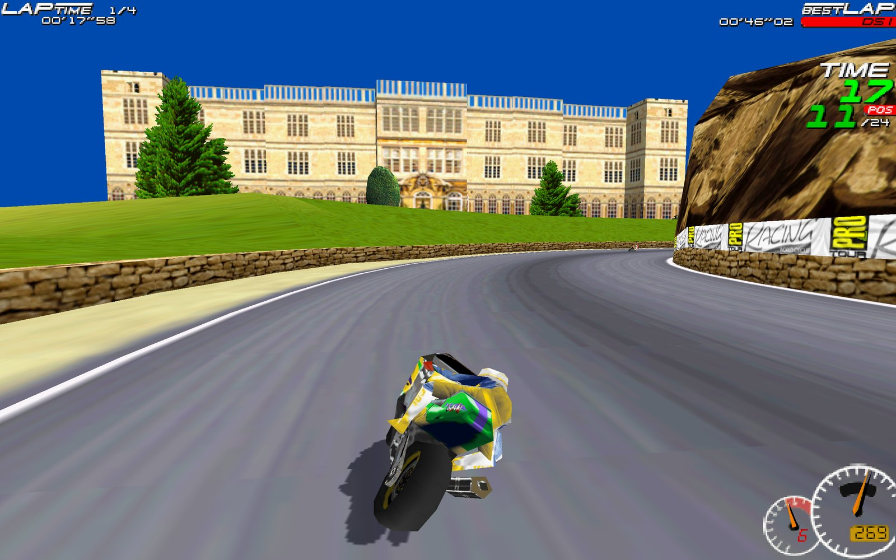
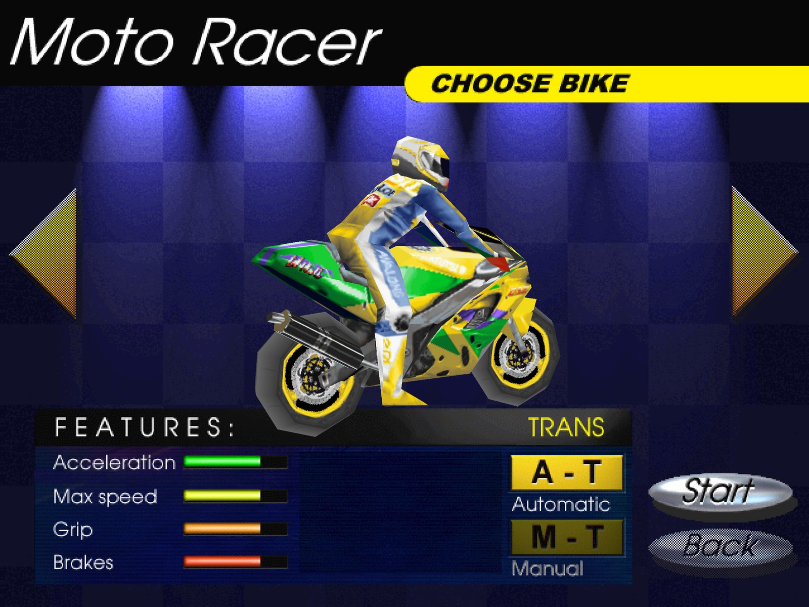

# Moto Racer Recomp

[](https://github.com/segovia-no/MotoRacerRecomp/releases)

[](LICENSE)
[](https://segovia-no.github.io/MotoRacerRecomp/)


Play **Moto Racer** (Delphine Software, 1997) natively on modern Macs, Windows and Linux PCs and the **Steam Deck**: in widescreen, at up to 4K, with a gamepad.

This is a *static recompilation*: the original Windows game executable from your GOG copy is translated to C and compiled into a native program on your own computer, linked against a small runtime that re-implements the Windows, DirectDraw/Direct3D, DirectSound and CD-audio parts the game needs. No emulator, no Wine: the game runs as a native Apple Silicon, Windows x64 or x86-64 Linux program.

> **You need your own copy of the game.** Buy *Moto Racer* on [GOG](https://www.gog.com/game/moto_racer) and download the offline installer (`setup_moto_racer_2.1.0.11.exe`). This repository and its downloads contain no game code or assets; everything is made from your installer on your own computer.

## Install
1. **Download** the package for your system from the [Releases page](https://github.com/segovia-no/MotoRacerRecomp/releases):

   | System | Download | Needs |
   |---|---|---|
   | Mac (Apple Silicon) | `MotoRacer-macos-arm64.zip` | macOS 12 or later |
   | Windows | `MotoRacer-windows-x86_64.zip` | Windows 10 or 11, 64-bit |
   | Steam Deck / Linux | `MotoRacer-linux-x86_64.tar.xz` | x86-64, glibc 2.29 or later |

2. **Put the GOG installer in your Downloads folder** (`setup_moto_racer_2.1.0.11.exe`: GOG › Moto Racer › Download offline backup game installers).
3. **Unpack the download and start Moto Racer** (details for your system below). On the first start it shows a setup screen:
   - It finds the GOG installer in your Downloads folder: choose **Install**. Elsewhere? Choose **Choose installer...** and select it.
   - It unpacks the game files and builds the game code on your computer, with a progress bar. This takes a minute or two and happens only once (and once after an update).
   - Then the game starts. From now on it starts straight away.

Everything needed for this comes in the download (Python, a C compiler and an installer unpacker, about 300 MB). Nothing is installed system-wide and nothing else is downloaded. Keep about 1.5 GB free.

### Mac
- Double-click the zip, then move **MotoRacer.app** to your Applications folder and open it.
- The app is not notarized by Apple, so the first open is blocked ("Apple could not verify…"). Choose **Done**, then open **System Settings › Privacy & Security**, scroll down and choose **Open Anyway** next to MotoRacer. (macOS 12–14: right-click the app › **Open** › **Open**.) You only do this once.
- Still blocked? In Terminal: `xattr -dr com.apple.quarantine /Applications/MotoRacer.app`

### Windows
- Right-click the zip › **Extract All…**, then open the **MotoRacer** folder and double-click **motoracer.exe**.
- If SmartScreen says "Windows protected your PC": **More info › Run anyway** (the program is not code-signed).
- Keep `motoracer.exe` next to its `kit` folder. To start it from the Start menu or the desktop, right-click `motoracer.exe` › **Show more options › Send to › Desktop (create shortcut)**, or pin it to Start.

### Steam Deck
1. In **Desktop Mode**, download the GOG installer and the Linux package with the browser (both land in Downloads).
2. In Dolphin (the file manager), right-click `MotoRacer-linux-x86_64.tar.xz` › **Extract › Extract archive here**. Move the **MotoRacer** folder wherever you like, e.g. your home folder.
3. Add it to Steam: in Steam choose **Games › Add a Non-Steam Game to My Library… › Browse…**, pick **MotoRacer/motoracer** and **Add Selected Programs**.
4. Start it once from Steam in Desktop Mode, so the setup screen can build the game (it finds the installer in Downloads; choose **Install**).
5. Back in **Game Mode**, start *Moto Racer* from your library (under Non-Steam).
   - Controls: Steam gives new non-Steam games a keyboard layout. Once, open the game's controller settings (Steam button › Controller settings) and choose **Gamepad with Joystick Trackpad**; Steam remembers it.
   - The game starts in 16/9 MODE at the Deck's native **1280×800**. Docked to a TV? Choose e.g. 1920×1080 in Options › SCREEN MODE.

### Linux PC
Unpack and run:
```sh
tar -xJf ~/Downloads/MotoRacer-linux-x86_64.tar.xz -C ~
~/MotoRacer/motoracer
```
Keep `motoracer` next to its `kit` folder.

### Updating
Download the new package and replace the old one (the app, or the MotoRacer folder). On the next start it rebuilds the game code once ("UPDATING"); your saves, best times and settings stay where they are (see [Settings](#settings)).

## Features
<p> </p>

- Native macOS app (Apple Silicon), Windows program or Linux / Steam Deck program, made from your GOG installer on the first start.
- The game's Direct3D renderer on the GPU (SDL_GPU: Metal, Vulkan or Direct3D 12) — or its original software renderer (Options › D3D: OFF).
- **True widescreen**: the game's own 16/9 mode at native 1280×720, 1920×1080, 2560×1440 or 3840×2160, or 16:10 at 1280×800 (Steam Deck), 1920×1200 or 2560×1600, chosen in the game's Options › SCREEN MODE.
- Race HUD scaled to the resolution, longer draw distance and smoother opponent level of detail.
- **Gamepads** (Xbox, PlayStation, Switch Pro, 8BitDo, …): analog throttle/brake on the triggers, menu navigation with the d-pad/stick, a ready-made layout.
- CD music from the GOG audio tracks, sound effects, working volume sliders.
- Good defaults on first start: fullscreen, 16/9 mode at a native resolution for your display (16:10 on 16:10 screens), JOYSTICK controls on a Steam Deck.

## Controls
**Keyboard** (as in the original; change them in Options › CONTROLLER › config): arrows to steer, accelerate and brake, **A**/**Z** gear up/down, **Space** turbo/stunts, **Esc** pause, **F7** speedometer style (dials › digital › hidden).

**Gamepad** (Xbox 360 layout; PlayStation and Switch pads map by button position):

| Action | Button |
|---|---|
| Accelerate / brake (analog) | **RT** / **LT** |
| Steer | left stick |
| Gear up / down | **RB** / **LB** |
| Turbo / stunts / wheelie | **A** |
| Pause | **Start** |
| Speedometer style (dials › digital › hidden), in a race | **Back** / **View** |
| Menus | d-pad or left stick, **A** select, **B** back |

A gamepad connected on first start sets the game's CONTROLLER option to JOYSTICK with this layout. Plugged in later? Choose Options › CONTROLLER › JOYSTICK and the layout is applied (it never overwrites bindings you made yourself).

**Window**: **Alt+Enter** (also **Cmd+F** on macOS) toggles fullscreen; **Cmd+Q** quits on macOS.

## Settings
Most settings are the game's own, in **Options**:
- **SCREEN MODE** — with 16/9 MODE on: 16:9 1280×720 … 3840×2160 and 16:10 1280×800 … 2560×1600 (rendered natively); off: 4:3 modes up to 1920×1440.
- **16/9 MODE** — widescreen.
- **D3D** — OFF (original software renderer, original resolutions), ON, FILTERED (smooth textures).
- **DETAIL LEVELS**, opponents, volumes, controller.

The port's own settings are in **Options › Recomp** (the button that was Info; it opens the Recomp settings page, in the game's look): frame rate, vsync, scaling filter, HUD scale, draw distance, widescreen crop, gamepad in menus. Enter or a click changes a value, Escape / gamepad B goes back; changes are saved at once.

All port options live in the `[Recomp]` section of `motoracer.ini` in the game folder (`~/Library/Application Support/MotoRacerRecomp/game` on macOS, `~/.local/share/MotoRacerRecomp/game` on Linux, `%LOCALAPPDATA%\MotoRacerRecomp\game` on Windows):

| Setting | Default | Meaning |
|---|---|---|
| `FrameRate` | `game` | `game` (the game's 60), `display` (the screen's refresh rate), a number such as `120` or `144`; races play at the same speed at any rate |
| `Fullscreen` | `1` (from setup) | start in fullscreen |
| `HiDPI` | `auto` | Retina/HiDPI displays: `auto` uses full-resolution window buffers only when the screen mode is wider than the window in points (saves ~130 MB fullscreen on a 5K Mac), `on`, `off` |
| `WindowWidth`, `WindowHeight` | `1280`, `960` | initial window size |
| `VSync` | `1` | sync to the display |
| `Filter` | `linear` | scaling filter for the picture: `linear` or `nearest` |
| `IntegerScale` | `0` | `1` = only whole-number scaling (sharp pixels, may add borders) |
| `DrawDistance` | `2` | track sections drawn ahead, opponent draw distance and detail, as a multiple of the original (`1` = original) |
| `HudScale` | `auto` | race HUD size in large modes: `auto` (width ÷ 640), a factor such as `2`, or `1` (off) |
| `Widescreen` | `auto` | show the game's 16/9 band as a true 16:9 picture; `off` keeps the letterbox |
| `CustomModes` | `1` | offer the extra resolutions in SCREEN MODE |
| `RenderScale` | `auto` | Direct3D supersampling: `auto` upscales the game's original modes to the display, larger modes render natively; or `1`…`4` |
| `ControllerPreset` | `1` | apply the Xbox layout described above |
| `ControllerMenus` | `1` | navigate the menus with a gamepad |
| `TriggerMode` | `auto` | triggers as analog throttle/brake in JOYSTICK mode, as buttons 9/10 otherwise; or `axis` / `buttons` |
| `Renderer` | `d3d` | `software` forces the original renderer everywhere (the in-game D3D option is usually enough) |

## Troubleshooting
- **Log**: `~/Library/Logs/MotoRacerRecomp/motoracer.log` on macOS, `~/.local/state/MotoRacerRecomp/motoracer.log` on Linux, `%LOCALAPPDATA%\MotoRacerRecomp\logs\motoracer.log` on Windows (the previous run is kept as `motoracer.log.1`). Please attach it to bug reports.
- **Setup screen error**: it shows the last lines of the failing step and the log path; attach the log to a [bug report](https://github.com/segovia-no/MotoRacerRecomp/issues).
- **Reinstall the game files**: delete the `game` and `gamecode` folders in the data folder (below) and start again; to keep saves and settings, first copy `game/data/CONFIG.BPT`, `game/data/bestscor.dat`, `game/motoracer.ini` and `game/recomp_state.txt` aside. Source builds: `./setup.sh path/to/installer.exe` again.
- **Reset settings**: delete the `[Recomp]` section of `motoracer.ini` and `recomp_state.txt` in the game folder; the game's own options are in `data/CONFIG.BPT`.
- **Uninstall**: delete the app (or the MotoRacer folder) and the data folder: `~/Library/Application Support/MotoRacerRecomp` (macOS), `~/.local/share/MotoRacerRecomp` (Linux), `%LOCALAPPDATA%\MotoRacerRecomp` (Windows). Source builds also made `~/Applications/MotoRacer.app` (macOS), `~/.local/share/applications/motoracer-recomp.desktop` (Linux) or a Start menu shortcut (Windows).
- The build only accepts the GOG `game.EXE` (checked by hash), because the recompiler's analysis is specific to that binary.

## Build from source
For development, or a system without a package. Each script installs what it needs and builds the game from your GOG installer.

**macOS** (Xcode Command Line Tools: `xcode-select --install`, and [Homebrew](https://brew.sh)):
```sh
git clone https://github.com/segovia-no/MotoRacerRecomp.git
cd MotoRacerRecomp
./setup.sh ~/Downloads/setup_moto_racer_2.1.0.11.exe
```
It installs `cmake`, `sdl3` and `innoextract` with Homebrew, unpacks the installer to `~/Library/Application Support/MotoRacerRecomp/game`, builds the game and puts **MotoRacer.app** in `~/Applications`.

**Steam Deck / Linux**: the same commands in Konsole (Desktop Mode); no sudo or developer mode. It builds inside Valve's Steam Runtime SDK container with `podman` (preinstalled on SteamOS; other distributions: `podman` or `docker`), installs to `~/.local/share/MotoRacerRecomp`, adds a menu entry and, if Steam is running, a Steam library entry. The first run downloads about 2 GB of build images.

**Windows**: clone the repository (or **Code › Download ZIP**), put the GOG installer in Downloads and double-click **`setup.cmd`** (or drop the installer onto it). Python 3 is installed for your user with winget if missing; llvm-mingw, innoextract, CMake and Ninja are downloaded into the project's `build` folder (pinned, checksum-verified). The game goes to `%LOCALAPPDATA%\MotoRacerRecomp` with a Start menu entry.

To update after a `git pull`, run the setup again (no argument needed). Saves, best times and settings are kept.

### Building by hand
```sh
brew install cmake sdl3 innoextract
python3 -m venv .venv && .venv/bin/pip install -r recompiler/requirements.txt   # + unicorn for the tests
scripts/setup/install_game.sh ~/Downloads/setup_moto_racer_2.1.0.11.exe
cmake -S . -B build/cmake -DCMAKE_C_COMPILER=clang -DCMAKE_CXX_COMPILER=clang++ -DCMAKE_ASM_COMPILER=clang \
      -DGAME_EXE="$HOME/Library/Application Support/MotoRacerRecomp/game/game.EXE"
cmake --build build/cmake -j
build/cmake/motoracer                          # run directly, or:
cmake --build build/cmake --target app         # -> build/cmake/MotoRacer.app
```
On Linux without containers: install cmake, a C/C++ compiler, Python 3 and innoextract from your distribution, and add `-DMOTORACER_BUNDLED_SDL=ON` if it has no SDL3 3.2+ (or see `scripts/setup/linux/sdk_build.sh` for the container build).

Game files are found in this order: `--game-dir DIR`, `$MOTORACER_GAME_DIR`, `<data dir>/MotoRacerRecomp/game` (`~/Library/Application Support` on macOS, `$XDG_DATA_HOME` or `~/.local/share` on Linux), `./extracted/app`.

Developer aids: `--trace` logs every Windows API call; environment overrides `MOTORACER_SNAPSHOT_DIR` / `MOTORACER_SNAPSHOT_EVERY` (save frames as BMP), `MOTORACER_RENDERER`, `MOTORACER_RENDER_SCALE`, `MOTORACER_DRAW_DISTANCE`, `MOTORACER_D3D_DEBUG=1`, `MOTORACER_GAME_DIR`. Unattended end-to-end tests drive the menus with scripted keys: `scripts/dev/e2e.sh`, `scripts/dev/e2e_race.sh` ([docs/notes/13-e2e-testing.md](docs/notes/13-e2e-testing.md)). The translator is checked instruction by instruction against the Unicorn emulator: `.venv/bin/python recompiler/tests/difftest.py <game.EXE> <work dir>`. After editing `runtime/shaders/`, regenerate the compiled shaders with `scripts/dev/build_shaders.sh` (needs `glslang` and `spirv-cross`).

## PSP
A PSP version runs on real hardware with custom firmware (every model, PSP-1000 included; about 25–30
fps in races). It is built from your GOG installer on macOS, Linux or Windows:
```sh
./setup.sh --psp ~/Downloads/setup_moto_racer_2.1.0.11.exe     # macOS / Linux
```
On Windows, double-click **`setup.cmd --psp`** (it builds in WSL). Then copy `build/psp-hw/PSP` to the
memory stick. Details, requirements and controls: [docs/guides/psp-build.md](docs/guides/psp-build.md).

## How it works
1. `recompiler/` finds every function in `game.EXE` (recursive descent, relocations, MSVC switch tables and exception-handling patterns) and translates each x86 instruction to C — integer operations with exact flags, the x87 FPU, MMX and the software rasterizer's self-modifying code.
2. `runtime/` provides the guest address space, Win32 (KERNEL32/USER32 with MFC-compatible window management, GDI, registry, files), C++/SEH exceptions, DirectDraw, Direct3D (execute buffers → SDL_GPU/Metal), DirectSound, an emulated CD-audio drive backed by the GOG audio tracks, joysticks via SDL gamepads, and presentation.
3. A few game-specific fixes are applied at translation time or through small hooks — e.g. relocating the 3D engine's 480-row tables so it can render above 480 lines, the widescreen mode list, HUD scaling and draw distance.

The reverse-engineering notes and design decisions are in [docs/](docs/README.md).

## Roadmap
See [docs/notes/12-roadmap.md](docs/notes/12-roadmap.md) and [docs/notes/15-ports-plan.md](docs/notes/15-ports-plan.md): 21:9, CI builds, and hand-decompiling game modules into readable C++.

## Distribution and legal
The downloads on the Releases page contain only the runtime and the build tools — no game code, no game assets and nothing translated from `game.EXE`. The game code is made on each player's computer from their own GOG copy. What that produces — the game files and the compiled game code in the data folder (`gamecode`), and for source builds the generated C in `build/cmake/gen/`, the `motoracer` binary and `MotoRacer.app` — contains code translated from your `game.EXE` and must **not** be redistributed.

The recompiler, runtime and documentation are released under the [MIT License](LICENSE); the license does not cover Moto Racer itself or anything generated from it.

This is an unofficial fan project for preservation and interoperability. It is not affiliated with or endorsed by Delphine Software, the current rights holders of Moto Racer, or GOG. "Moto Racer" and related names are trademarks of their respective owners.
