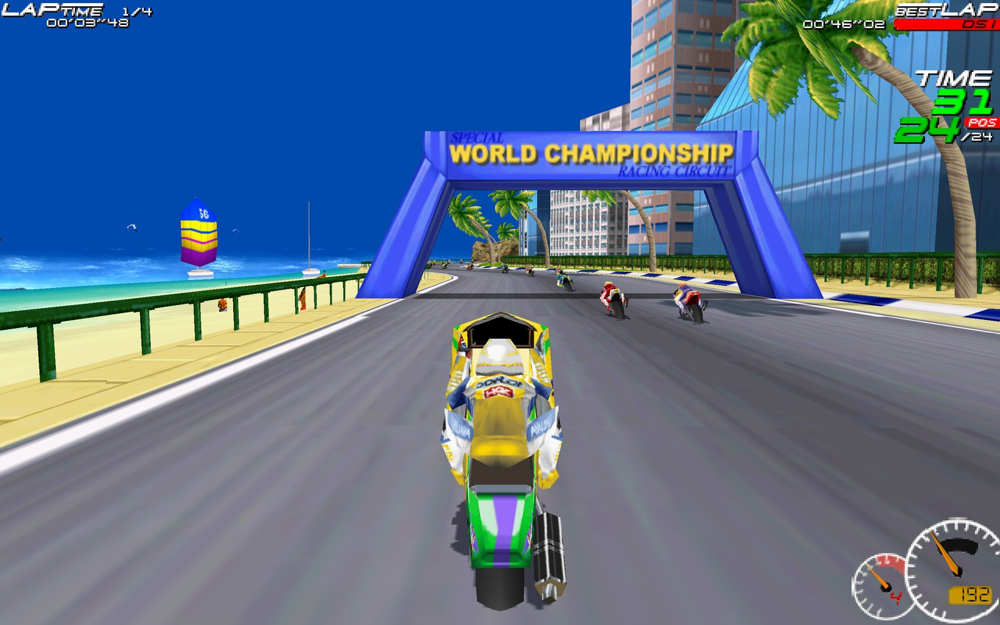

# Moto Racer Recomp

Play **Moto Racer** (Delphine Software, 1997) natively on modern Macs, Windows and Linux PCs, the **Steam Deck** and the **PSP**: in widescreen, at up to 4K, with a gamepad.

This is a *static recompilation*: the original Windows game executable from your GOG copy is translated to C and compiled into a native program on your own computer, linked against a small runtime that re-implements the Windows, DirectDraw/Direct3D, DirectSound and CD-audio parts the game needs. No emulator, no Wine.

> **You need your own copy of the game.** Buy *Moto Racer* on [GOG](https://www.gog.com/game/moto_racer) and download the offline installer (`setup_moto_racer_2.1.0.11.exe`). This repository and its downloads contain no game code or assets; everything is made from your installer on your own computer.

## Quick start
1. Download the package for your system from the [Releases page](https://github.com/segovia-no/MotoRacerRecomp/releases): Mac (Apple Silicon), Windows 10/11 or Steam Deck / Linux (x86-64).
2. Put the GOG installer in your Downloads folder.
3. Unpack the download and start Moto Racer. The first start unpacks the game and builds it on your computer (a minute or two, once).

Details for each system, updating and uninstalling: **[Install guide](docs/guides/install.md)**.

**PSP** (custom firmware, every model): built from your installer with `./setup.sh --psp` (macOS / Linux) or `setup.cmd --psp` (Windows) — see the **[PSP guide](docs/guides/psp-build.md)**.

## Documentation
| | |
|---|---|
| [Install](docs/guides/install.md) | download, first start, Mac / Windows / Steam Deck / Linux, updating, uninstall |
| [Playing](docs/guides/playing.md) | features, controls (keyboard, gamepad), settings |
| [Troubleshooting](docs/guides/troubleshooting.md) | logs, reinstalling game files, resetting settings |
| [PSP](docs/guides/psp-build.md) | building and installing the PSP version |
| [Building from source](docs/dev/building.md) | setup scripts, building by hand, developer aids |
| [Architecture](docs/dev/architecture.md) | how the recompiler and runtime work, repository layout |
| [Technical notes](docs/README.md) | reverse engineering, translator, runtime and port notes |

## Distribution and legal
The downloads on the Releases page contain only the runtime and the build tools — no game code, no game assets and nothing translated from `game.EXE`. The game code is made on each player's computer from their own GOG copy. What that produces — the game files and the compiled game code in the data folder (`gamecode`), and for source builds the generated C in `build/cmake/gen/`, the `motoracer` binary, `MotoRacer.app` and the PSP package — contains code translated from your `game.EXE` and must **not** be redistributed.

The recompiler, runtime and documentation are released under the [MIT License](LICENSE); the license does not cover Moto Racer itself or anything generated from it.

This is an unofficial fan project for preservation and interoperability. It is not affiliated with or endorsed by Delphine Software, the current rights holders of Moto Racer, or GOG. "Moto Racer" and related names are trademarks of their respective owners.
