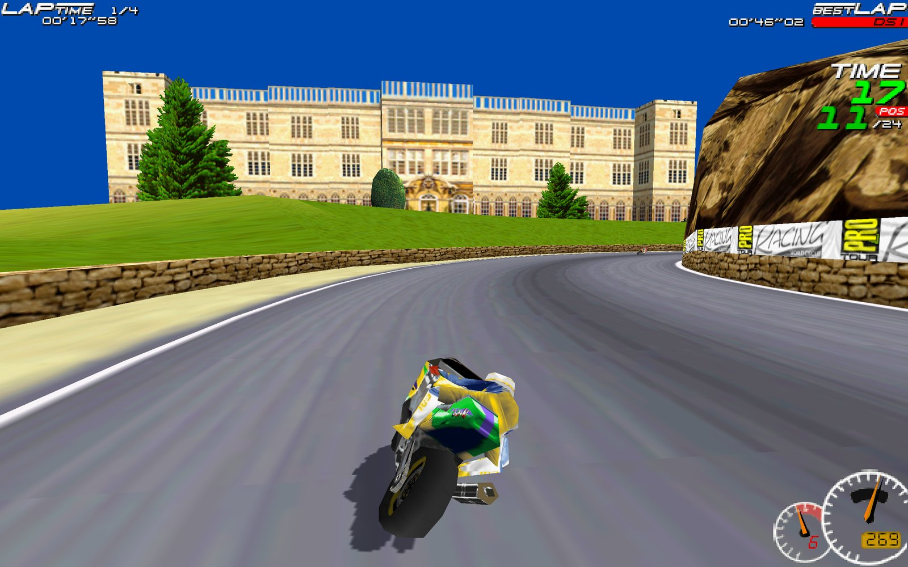
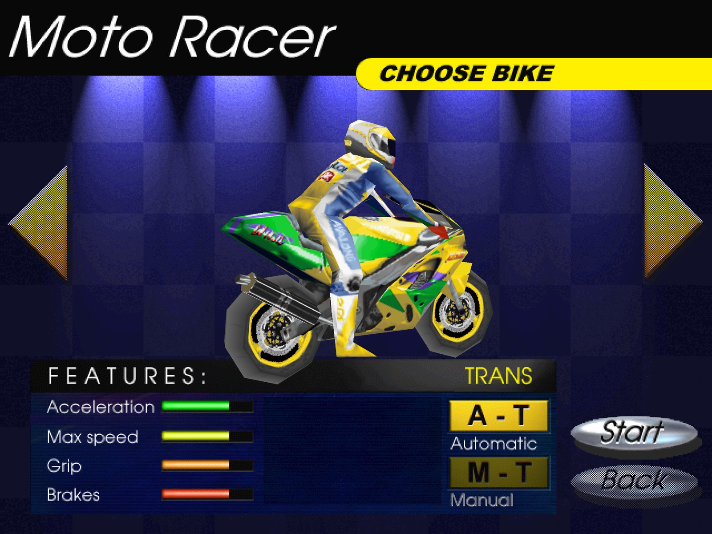

# Playing: features, controls, settings

## Features

 

- Native macOS app (Apple Silicon), Windows program or Linux / Steam Deck program, made from your GOG installer on the first start.
- The game's Direct3D renderer on the GPU (SDL_GPU: Metal, Vulkan or Direct3D 12) — or its original software renderer (Options › D3D: OFF).
- **True widescreen**: the game's own 16/9 mode at native 1280×720, 1920×1080, 2560×1440 or 3840×2160, or 16:10 at 1280×800 (Steam Deck), 1920×1200 or 2560×1600, chosen in the game's Options › SCREEN MODE.
- Race HUD scaled to the resolution, longer draw distance and smoother opponent level of detail.
- **Gamepads** (Xbox, PlayStation, Switch Pro, 8BitDo, …): analog throttle/brake on the triggers, menu navigation with the d-pad/stick, a ready-made layout.
- CD music from the GOG audio tracks, sound effects, working volume sliders.
- Good defaults on first start: fullscreen, 16/9 mode at a native resolution for your display (16:10 on 16:10 screens), JOYSTICK controls on a Steam Deck.

## Controls
**Keyboard** (as in the original; change them in Options › CONTROLLER › config): arrows to steer, accelerate and brake, **A**/**Z** gear up/down, **Space** turbo/stunts, **Esc** pause, **F7** speedometer style (dials › digital › hidden).

**Gamepad** (Xbox 360 layout; PlayStation and Switch pads map by button position):

| Action | Button |
|---|---|
| Accelerate / brake (analog) | **RT** / **LT** |
| Steer | left stick |
| Gear up / down | **RB** / **LB** |
| Turbo / stunts / wheelie | **A** |
| Pause | **Start** |
| Speedometer style (dials › digital › hidden), in a race | **Back** / **View** |
| Menus | d-pad or left stick, **A** select, **B** back |

A gamepad connected on first start sets the game's CONTROLLER option to JOYSTICK with this layout. Plugged in later? Choose Options › CONTROLLER › JOYSTICK and the layout is applied (it never overwrites bindings you made yourself).

**Window**: **Alt+Enter** (also **Cmd+F** on macOS) toggles fullscreen; **Cmd+Q** quits on macOS.

### PSP controls
| Action | Button |
|---|---|
| Accelerate / brake | **Cross** / **Square** |
| Steer | analog stick or d-pad |
| Gear up / down | **R** / **L** |
| Stunts / turbo | **Circle** |
| Pause | **Start** |
| Speedometer style | **Select** |
| Menus | d-pad, **Cross** confirm, **Circle** back |

## Settings
Most settings are the game's own, in **Options**:
- **SCREEN MODE** — with 16/9 MODE on: 16:9 1280×720 … 3840×2160 and 16:10 1280×800 … 2560×1600 (rendered natively); off: 4:3 modes up to 1920×1440.
- **16/9 MODE** — widescreen.
- **D3D** — OFF (original software renderer, original resolutions), ON, FILTERED (smooth textures).
- **DETAIL LEVELS**, opponents, volumes, controller.

The port's own settings are in **Options › Recomp** (the button that was Info; it opens the Recomp settings page, in the game's look): frame rate, vsync, scaling filter, HUD scale, draw distance, widescreen crop, gamepad in menus. Enter or a click changes a value, Escape / gamepad B goes back; changes are saved at once.

On the PSP the game plays in its 16/9 mode in a 480×360 screen mode whose 16/9 band (480×270) fills the PSP's screen; keep SCREEN MODE, 16/9 MODE and D3D as they start. Its `motoracer.ini` is on the memory stick in `PSP/GAME/MOTORACER/game/`; the package sets `DrawDistance=1` (the original: higher costs about a third of the frame rate) and thins the updates of opponents far out of sight (`AiLod`, on by default on the PSP), so races keep their speed at 25–30 fps.

All port options live in the `[Recomp]` section of `motoracer.ini` in the game folder (`~/Library/Application Support/MotoRacerRecomp/game` on macOS, `~/.local/share/MotoRacerRecomp/game` on Linux, `%LOCALAPPDATA%\MotoRacerRecomp\game` on Windows):

| Setting | Default | Meaning |
|---|---|---|
| `FrameRate` | `game` | `game` (the game's 60), `display` (the screen's refresh rate), a number such as `120` or `144`; races play at the same speed at any rate |
| `Fullscreen` | `1` (from setup) | start in fullscreen |
| `HiDPI` | `auto` | Retina/HiDPI displays: `auto` uses full-resolution window buffers only when the screen mode is wider than the window in points (saves ~130 MB fullscreen on a 5K Mac), `on`, `off` |
| `WindowWidth`, `WindowHeight` | `1280`, `960` | initial window size |
| `VSync` | `1` | sync to the display |
| `Filter` | `linear` | scaling filter for the picture: `linear` or `nearest` |
| `IntegerScale` | `0` | `1` = only whole-number scaling (sharp pixels, may add borders) |
| `DrawDistance` | `2` | track sections drawn ahead, opponent draw distance and detail, as a multiple of the original (`1` = original) |
| `HudScale` | `auto` | race HUD size in large modes: `auto` (width ÷ 640), a factor such as `2`, or `1` (off) |
| `Widescreen` | `auto` | show the game's 16/9 band as a true 16:9 picture; `off` keeps the letterbox |
| `CustomModes` | `1` | offer the extra resolutions in SCREEN MODE |
| `RenderScale` | `auto` | Direct3D supersampling: `auto` upscales the game's original modes to the display, larger modes render natively; or `1`…`4` |
| `ControllerPreset` | `1` | apply the Xbox layout described above |
| `ControllerMenus` | `1` | navigate the menus with a gamepad |
| `TriggerMode` | `auto` | triggers as analog throttle/brake in JOYSTICK mode, as buttons 9/10 otherwise; or `axis` / `buttons` |
| `Renderer` | `d3d` | `software` forces the original renderer everywhere (the in-game D3D option is usually enough) |
